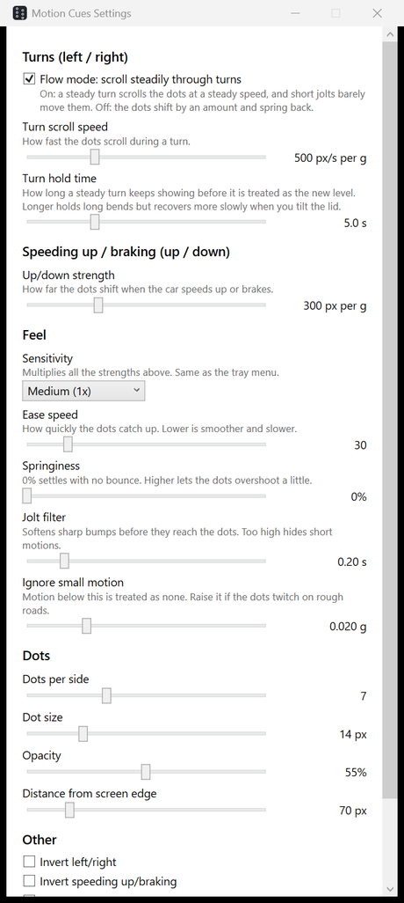

<p align="center"></p>

<h1 align="center">Motion Cues for Windows</h1>

<p align="center">Moving dots at the edges of your screen that follow the car's motion, so you can use a laptop as a passenger without getting car sick.<br>A Windows take on Apple's Vehicle Motion Cues.</p>

<p align="center"><a href="https://github.com/smithynb/motion-cues/releases/latest"><b>Download the latest release</b></a></p>

<p align="center"><a href="https://github.com/smithynb/motion-cues/actions/workflows/build.yml"></a></p>

---

Car sickness comes from a mismatch: your inner ear feels the car turn and brake, while your eyes see a still screen. Motion Cues draws two columns of dots near the left and right edges of the screen and moves them against the car's acceleration, using the laptop's built-in accelerometer. Your eyes then see the motion your body feels.

- When the car turns left, the dots scroll right. When it turns right, they scroll left.
- When the car speeds up, the dots move down. When it brakes, they move up.

The overlay is click-through and stays on top, so you can keep working normally.

## Download and run

1. Open the [latest release](https://github.com/smithynb/motion-cues/releases/latest) and download the zip for your laptop:
   - `MotionCues-win-x64.zip` for Intel and AMD laptops (most laptops).
   - `MotionCues-win-arm64.zip` for Snapdragon / ARM laptops.
2. Unzip it and double-click `MotionCues.exe`. Nothing to install, and you don't need .NET.
3. Windows may show "Windows protected your PC" because the exe isn't code-signed. Click **More info**, then **Run anyway**.

The app lives in the system tray. If you don't see the icon, check the tray overflow (^). The dots appear right away. **Ctrl+Alt+M** shows and hides them.

You need a laptop or tablet with an accelerometer. Most 2-in-1s and many recent laptops have one. If yours doesn't, the app tells you and offers a demo mode.

## Settings

Right-click the tray icon and choose **Settings...**. Every change applies live, so you can tune it while riding. The app saves when you close the window.

<p align="center"></p>

| Setting | What it does |
|---|---|
| Flow mode | On (default): a steady turn scrolls the dots at a steady speed, and short jolts barely move them. Off: the dots shift by an amount and spring back. |
| Turn scroll speed | How fast the dots scroll during a turn in flow mode. |
| Turn strength | How far the dots shift in a turn when flow mode is off. |
| Turn hold time | How long a steady turn keeps showing before the app treats it as the new level. |
| Up/down strength | How far the dots shift when the car speeds up or brakes. |
| Sensitivity | Low (0.6x), Medium (1x) or High (1.5x), applied to all the strengths. |
| Ease speed | How quickly the dots catch up. Lower is smoother. |
| Springiness | 0% settles without bouncing. Higher lets the dots overshoot a little. |
| Jolt filter | Softens sharp bumps before they reach the dots. |
| Ignore small motion | Motion below this is treated as none. |
| Dots | Number per side, size, opacity, and distance from the screen edge. Each dot shows an inverted view of the screen behind it. |
| Particle fountain | During a steady turn, speed-up or brake, extra dots of random size stream the way the dots move. Amount, speed, start level, spread, area width and size range are adjustable. Standing still shows only the regular dots. |
| Dim mode | Darkens the display itself past the lowest brightness setting, cursor and taskbar included. It scales the graphics card's gamma table, like the brightness and contrast sliders in the AMD or NVIDIA control panel, and makes up anything Windows refuses with a full-screen colour filter. Colours keep their hue. If the app crashes while dimmed, the next start restores the screen. |
| Other | Invert either direction, debug readout, start with Windows. |

The tray menu also has **Calibrate**, which resets the level to the current position. Click it after you adjust the lid, or if the dots creep while the car is stopped or driving straight.

Settings are stored in `%APPDATA%\MotionCues\settings.json`. A few advanced values, such as the sensor report interval and auto show/hide thresholds, are only in that file. Use **Reload settings file** in the tray after editing it.

### Tray menu

| Item | What it does |
|---|---|
| Settings... | Opens the settings window |
| Show dots (Ctrl+Alt+M) | Shows or hides the dots. Left-clicking the tray icon does the same. |
| Dim mode | Darkens the whole screen. Set the amount in Settings. |
| Invert X / Invert Z | Flips the left/right or speeding up/braking direction |
| Flow mode | Same as the setting above |
| Sensitivity | Low, Medium or High |
| Calibrate | Resets the level to the current position |
| Auto show/hide when moving | Shows the dots when the car is moving and hides them after 30 s of calm. Off by default. |
| Debug readout | Shows the raw sensor values, sample rate and output in the top-right corner |
| Demo mode | Drives the dots from a scripted 24 s drive, or from the arrow keys |
| Open / Reload settings file | Edits the JSON directly |

Run `MotionCues.exe --settings` to start the app with the settings window open, or `--demo` to start in demo mode.

The dots are hidden from screenshots and screen recordings, because the app reads the screen behind them. Set the environment variable `MOTIONCUES_CAPTURABLE=1` before starting the app to show plain grey dots that screenshots can see. Set `MOTIONCUES_PERFLOG` to a file path to log the frame rate, capture time and particle count once a second.

The app saves battery by drawing only two narrow strips at the screen edges, grabbing the screen on a background thread, and lowering its frame rate when the dots move slowly or stand still (about 10 fps when still, the full display rate during fast motion).

## Checking the directions in a car

Laptops mount the accelerometer differently, so check the directions once. Turn on **Debug readout**, sit with the laptop on your lap with the lid at your normal angle, and click **Calibrate** while the car is stopped.

1. Speed up firmly from a stop. The dots should move down, and `out lon` should be positive. If they move up, turn on **Invert Z**.
2. Brake. The dots should move up.
3. Turn left. The dots should scroll right, and `out lat` should be positive. If they scroll left, turn on **Invert X**.

You can check left/right at a desk. Slide the laptop quickly to the left and the dots should flick right. Don't test speeding up and braking by pushing the laptop forward on a desk, because the lid flexes and the result is unreliable.

## Tuning tips

- **The dots move too much or too little.** Change Sensitivity, or the turn and up/down sliders.
- **The return feels too fast and makes you queasy.** Lower Ease speed. Keep Springiness at 0%.
- **The dots twitch on rough roads.** Raise Ignore small motion to 0.03 to 0.04 g, or raise Jolt filter to about 0.3 s.
- **Long bends fade out halfway.** Raise Turn hold time to 8 to 10 s. The trade-off is that the dots creep for longer after you tilt the lid. Calibrate stops that immediately.
- **The dots sit off-center or creep after you move the laptop.** Click Calibrate.

## How it works

1. **Sampling.** The app reads `Windows.Devices.Sensors.Accelerometer` at about 60 Hz and uses the sensor's own timestamps.
2. **Gravity.** Without a gyroscope, gravity is estimated with an exponential low-pass filter (Turn hold time, default 5 s). The linear acceleration is the raw reading minus gravity.
3. **Tilt compensation.** The app projects the linear acceleration onto the horizontal parts of the device's X and Z axes. With the lid tilted back, the Z axis is partly vertical, and without this step road bumps would show up as speeding up or braking.
4. **Scaling.** Values are divided by the measured gravity magnitude, because some sensors report 1 g as something other than 1.0.
5. **Smoothing and limits.** A low-pass filter (Jolt filter), a soft deadzone (Ignore small motion), and a ±0.4 g clamp.
6. **Turns (flow mode).** The lateral acceleration sets the horizontal scroll speed of the dots. A car's yaw rate is lateral acceleration divided by speed, so a steady turn produces steady sideways flow, similar to the view out of a side window. A short jolt adds up to only a few pixels.
7. **Speeding up and braking.** The longitudinal acceleration sets a vertical offset, so the dots return to the middle when the car cruises. Flow is not used here because lid wobble mostly affects this axis and would make the dots creep.
8. **Display.** A critically damped spring follows the target at the display refresh rate. Each dot wraps inside its column band and the screen height, and fades near the wrap edges so large motion reads as smooth scrolling.

### Axis signs

Windows reports `reading = gravity - kinematic acceleration` in the device frame. +X points right along the screen, +Y up along the screen, and +Z out of the screen toward you. With the laptop on your lap facing you, the car's forward direction points into the screen (-Z) and its left is -X.

- In a left turn the car accelerates toward -X, so the X reading is positive and the dots move right.
- When the car speeds up it accelerates toward -Z, so the Z reading is positive, and the dots move down (WPF's y axis points down).

## Known limitations

- **No gyroscope.** A single accelerometer can't tell "the car is speeding up" apart from "the lid tilted a little". A 1° tilt shifts the reading by about 0.017 g. The gravity filter recovers within a few seconds, and Calibrate fixes it immediately. Left/right is much less affected, because the hinge doesn't rotate the lid sideways.
- Very long steady turns and on-ramps fade out over the Turn hold time.
- The overlay covers the primary monitor only.
- Exclusive-fullscreen games and secure screens (UAC prompts, the lock screen) draw over the dots.
- Ctrl+Alt+M does nothing if another app already uses it. The tray menu still works.

## Build from source

You need the [.NET 8 SDK](https://dotnet.microsoft.com/download/dotnet/8.0). It builds on Windows, Linux and macOS.

```
cd src
dotnet publish -c Release -r win-x64 --self-contained true -p:PublishSingleFile=true -o ../dist/win-x64
```

Use `-r win-arm64` for ARM. The output is a single `MotionCues.exe`. The project uses no third-party NuGet packages.

### Releasing

GitHub Actions builds both exes on every push. Pushing a version tag also publishes them as a release, each zipped:

```
git tag v1.0.1
git push origin v1.0.1
```

## License

[MIT](LICENSE)
